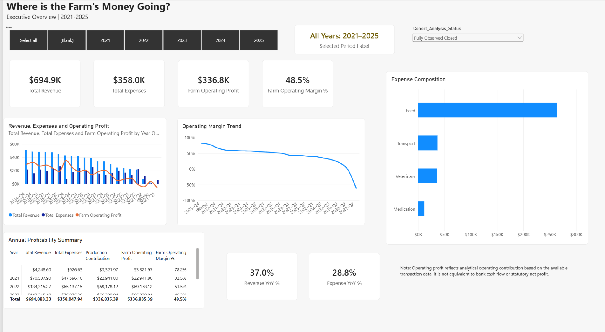
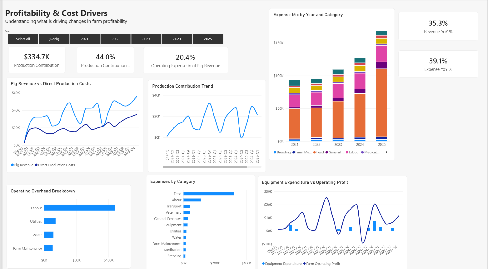

# Where Is the Farm's Money Going?

### Pig Farm Financial & Operational Analysis | Power BI Portfolio Project

**Project status:** In progress — two Power BI report pages completed  
**Reporting period:** 2021–2025 | **Business setting:** Synthetic pig farm in Zimbabwe | **Currency:** USD  
**Tools:** Power BI Desktop, Power Query, DAX, CSV

## The business challenge

A pig farm can sell pigs every month, grow its revenue, and still struggle to understand where its money is going. Feed, veterinary care, labour, transport, and other costs compete for the income generated by the business. Without a reliable reporting model, the farm owner cannot easily identify the biggest cost pressures, compare production batches, or determine whether side projects are helping.

This project uses a **fictional, small-to-medium pig farming business in Zimbabwe** to investigate that problem. The aim is to turn messy operational and financial records into a Power BI report that helps management ask better questions and make evidence-based decisions.

> **Guiding question:** Where is the farm's money going, and which factors are driving its financial performance?

## Questions the analysis explores

- How do revenue, expenses, and operating profit change from year to year and quarter to quarter?
- Which operating costs have the greatest effect on the farm's margins?
- Is feed expenditure increasing faster than pig-sales revenue?
- How do production contributions and profit margins change across reporting periods?
- Which pig cohorts are profitable, and how do mortality and production cycles affect their performance?
- Which customers and locations contribute most to revenue, and what are the implications of transport costs?
- Are the farm's two side projects creating or consuming financial value?

The first two report pages focus on **overall performance and cost drivers**. Cohort-level, customer, and side-project investigations are part of the wider project scope and are not presented here as completed analyses.

## Report preview

### Page 1 — Executive Overview



This page provides an at-a-glance view of the farm's reported financial performance:

- Cards for total revenue, expenses, farm operating profit, and operating margin.
- Quarterly revenue, expense, and operating-profit comparisons.
- An operating-margin view to inspect variations across periods.
- A composition chart identifying major expense categories.
- An annual profitability summary, year selection, and a cohort-analysis-status filter.

**Example of the report's displayed figures:** With the **“Fully Observed Closed”** cohort-status selection shown in the screenshot, the report displays approximately **$694.9K revenue**, **$358.0K expenses**, **$336.8K farm operating profit**, and a **48.5% operating margin**. These are **filter-context results**, not an assertion that the raw CSV ledger has those same totals.

### Page 2 — Profitability & Cost Drivers



This page moves from the overall result toward possible explanations:

- **Pig revenue vs. direct production costs** — examines how closely direct costs move with pig-sales revenue.
- **Production contribution trend** — shows the amount remaining after the direct production costs included in the measure.
- **Expense mix by year and category** — shows how spending is distributed and changes over time.
- **Operating overhead breakdown** — compares overhead categories such as labour, utilities, water, and maintenance.
- **Expenses by category** — identifies the largest recorded cost categories.
- **Equipment expenditure vs. operating profit** — provides context for irregular equipment spending alongside profitability.

In the displayed visuals, **feed is a major expense driver**, while the contribution and operating-profit trends vary across periods. These charts are designed to support further investigation rather than assume one cost category explains every change.

## The dataset

Four related **synthetic CSV files** support the analysis:

| Source file | Raw rows | Main content |
| --- | ---: | --- |
| `Transactions.csv` | 2,172 | Revenue and expense entries, dates, category, amount, quantity, unit price/cost, cohort/customer/supplier IDs, and payment details |
| `Pig_Cohorts.csv` | 39 | Production batches, breed, start and close dates, pigs started and sold, mortality, feed type, and weights |
| `Customers.csv` | 16 | Customer type, location, and region |
| `Suppliers.csv` | 12 | Supplier type and location |

The transaction table is the principal **fact-table candidate**, with cohorts, customers, suppliers, and a reporting date table providing dimensions for analysis. The common ID fields support relationships where those IDs are populated and applicable. Actual measure behaviour also depends on the Power BI model and the active filter context.

### Data quality and preparation

The source files intentionally contain issues intended for Power Query practice. Examples identified in the uploaded **raw** transactions file include:

- **212 missing `Quantity` values**; some transactions may not require a quantity.
- **14 exact duplicate rows**.
- **4 dates that cannot be parsed as standard calendar dates**, plus **3 dated records in 2026–2028**, outside the intended reporting window.
- Inconsistent category labels (for example, `Pig Sales`, `Pig_Sale`, `Pigs`, and `Swine Sales`), along with variations in payment-method text.
- Missing category or cohort assignments in some records, negative amounts, and unusual transaction values that require review.

The data-preparation approach is to **profile before cleaning, standardise where justified, and flag ambiguous records rather than silently inventing values**. Missing cohort IDs are not automatically errors: some farm-wide costs do not belong to a single production batch.

**Important:** Counts above describe the supplied raw CSV, not a claim that every listed issue remains in the transformed Power BI queries. Raw file totals may differ from report totals after cleaning and filtering.

## Analytical approach and skills demonstrated

1. **Understand the business problem:** Convert a broad concern about shrinking available funds into financial and operational questions.
2. **Prepare the data:** Examine quality issues, review duplicates and dates, standardise categories, and preserve a defensible cleaning trail.
3. **Model the data:** Use fact/dimension relationships and date-based filtering to support meaningful cross-table analysis.
4. **Calculate KPIs in DAX:** Report revenue, expenses, operating profit, operating margin, production contribution, and year-over-year comparisons.
5. **Explore cost drivers:** Compare direct production costs, overheads, expenses by category, and changes across periods.
6. **Communicate results:** Build business-focused report pages with cards, comparison charts, slicers, and descriptive titles.

## Interpretation and limitations

- **Operating profit is not the same as cash in the bank.** The dataset does not include opening bank balances or actual settlement dates, so it cannot establish a closing bank balance or full cash-flow position.
- **Cohort completeness matters.** Some cohorts began before 2021, outside the ledger's reporting window; others were still open at the end of 2025. Their observed revenue and costs do not necessarily represent full-lifecycle profitability. The report therefore includes a cohort-analysis-status selection.
- **Filter context matters.** Selecting a cohort status, period, or other filter can materially change the figures displayed. Comparisons should use consistent definitions and selections.
- **This is a synthetic learning dataset.** The business, transactions, and financial outcomes are illustrative, not a statement about a real farm.

## Project progress and next steps

**Completed report pages:** Executive Overview; Profitability & Cost Drivers.

**Planned investigations:** Pig cohort profitability and mortality; customers and location-related transport costs; financial evaluation of Side Projects A and B; deeper drillthrough and tooltip analysis; and a final evidence-based management recommendations page.

The goal is a portfolio case study that demonstrates the **reasoning behind the analysis**, not simply a collection of charts.

## Repository contents

```text
.
├── README.md
├── data/
│   ├── Transactions.csv
│   ├── Pig_Cohorts.csv
│   ├── Customers.csv
│   └── Suppliers.csv
├── images/
│   ├── Results-Where-IsTheMoneyGoing.png
│   └── Results-ProfitabilityAndCostDrivers.png
└── [Power BI .pbix file — add when ready to share]
```

**To explore this project:** Review the two screenshots above for the current report pages. If a `.pbix` file is added to the repository, open it with Power BI Desktop to inspect the data model, measures, and interactive report. The CSV files are the deliberately unclean source data, not an export of the final cleaned model.

---

*Portfolio case study built with synthetic data for learning and demonstration. Analysis will be extended as additional report pages are completed.*
